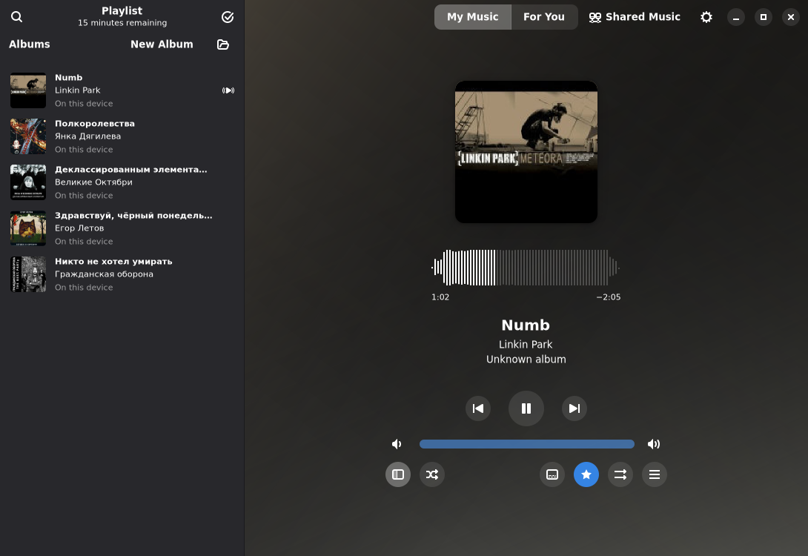
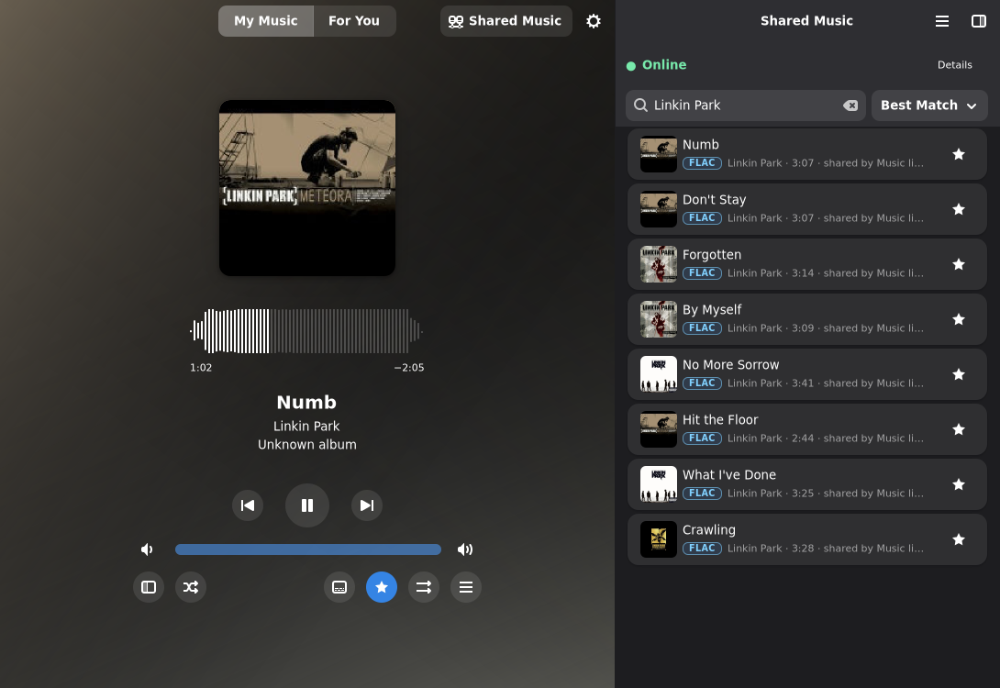
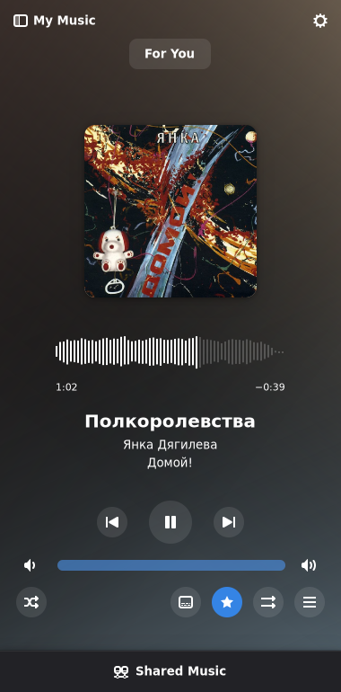
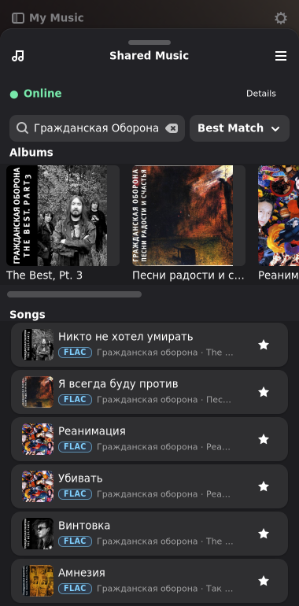

# Hopea


A music player for your own collection and music shared by other listeners.
Built with Rust, GTK 4 and libadwaita, based on **Amberol**.

- Play local files, organize albums and keep your favorite songs together.
- Search the peer-to-peer network and listen to music shared by other Hopea users.
- Import your collection from supported music services or exported playlists.
- See waveforms, read lyrics and control playback while using other apps.

## Screenshots

### Desktop





### Mobile

<p>
  
  
</p>

The English interface with downloaded tracks and their album artwork.
Mobile images show the adaptive layout. [Screenshot details](docs/SCREENSHOTS.md).

## Get Hopea

Download an **alpha** build from [GitHub Releases](https://github.com/PuffyWithEyes/Hopea/releases).
Choose the package for your operating system. Android previews require Android 9
or newer; choose ARM64, ARMv7 (32-bit), or x86-64 to match your device.

Linux, Windows, macOS and BSD have platform-specific builds or installation
recipes. Availability and runtime testing differ between platforms; see
[platform notes](docs/PLATFORMS.md) and the [package guide](packaging/README.md).
For NixOS and Home Manager, use the [Nix guide](nix/README.md).

## Build and run

With Nix installed, from the project directory:

```sh
nix-shell nix/shell.nix --run 'meson setup _builddir . -Dprofile=development'
nix-shell nix/shell.nix --run 'meson compile -C _builddir'
nix-shell nix/shell.nix --run 'meson devenv -C _builddir ./src/hopea'
```

Use [the contributing guide](docs/CONTRIBUTING.md) for development and tests,
or [platform notes](docs/PLATFORMS.md) for other build environments.

## Learn more

- [Importing music](docs/IMPORTING.md) and [service sign-in](docs/SERVICE_SIGN_IN.md).
- [Translations and contributions](docs/CONTRIBUTING.md).
- [Architecture](docs/ARCHITECTURE.md) and [the sharing node](node/README.md).
- [Packaging](packaging/README.md) and [making a release](docs/RELEASING.md).
- [Report a bug](https://github.com/PuffyWithEyes/Hopea/issues).

Service imports require an active subscription under Hopea's import rules.
A subscription does not grant permission to redistribute music: share only
what you have permission to share. Network search depends on available peers
and reachable connections; a result is not guaranteed for every song.

## Credits and license

Hopea is a fork of [Amberol](https://gitlab.gnome.org/World/amberol).
The player retains the original work and copyright notices of Emmanuele Bassi
and its contributors. Hopea's sharing and import features are by Daniil Klimov.

Code is licensed under GPL-3.0-or-later. See the per-file SPDX notices,
[LICENSES](LICENSES) and [ADDITIONAL-TERMS.md](ADDITIONAL-TERMS.md).
